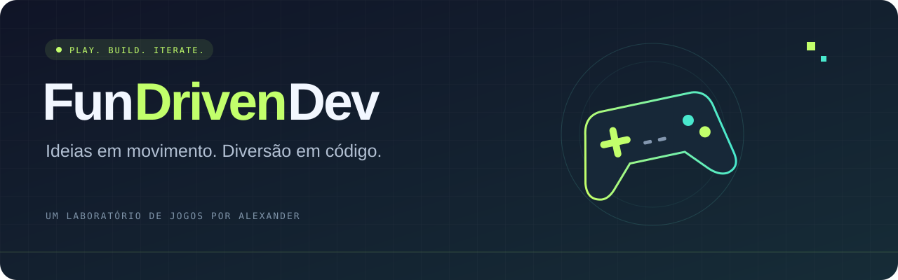

<div align="center">



**Um laboratório independente para transformar ideias em jogos.**  
Criar, experimentar, aprender e voltar para mais uma partida.

[](https://github.com/4L3xSGS/FunDrivenDev/actions/workflows/quality.yml)


[Explorar jogos](#-escolha-sua-próxima-partida) · [Começar](#-do-repositório-para-a-arena) · [Contribuir](CONTRIBUTING.md) · [Roadmap](docs/ROADMAP.md)

</div>

## 🎮 Escolha sua próxima partida

| Jogo | A experiência | Tecnologia | Estado |
| :--- | :--- | :--- | :--- |
| **[Duelo de Tanques](jogos/duelo-de-tanques/)** | Dois tanques em movimento aleatório. Um tiro a cada 3 segundos. O primeiro atingido perde. | HTML Canvas · JavaScript | Protótipo |

**Um conceito por vez. Uma experiência completa por jogo.**

O catálogo cresce conforme novos jogos são desenvolvidos. Cada projeto tem sua própria pasta, regras e histórico, sem misturar experimentos nem perder versões anteriores.

> **Onde jogar:** baixe o repositório e abra `index.html` no navegador. Os links do GitHub mostram arquivos e documentação; a publicação online ainda não está configurada.

## ⚡ Do repositório para a arena

**Sem terminal**

1. Clique em **Code → Download ZIP**.
2. Extraia o arquivo.
3. Abra o `index.html` da raiz e escolha um jogo.

**Com Git**

```bash
git clone https://github.com/4L3xSGS/FunDrivenDev.git
cd FunDrivenDev
python3 -m http.server 8000 --bind 127.0.0.1
```

Acesse **http://localhost:8000**. Python é opcional para servir os arquivos; os jogos atuais também abrem diretamente no navegador.

## 🧪 Diversão como ponto de partida

O **FunDrivenDev** é a central dos jogos criados neste projeto por **Alexander**, com apoio de IA no desenvolvimento. A proposta é explorar mecânicas, dar forma a ideias e evoluir com partidas reais e feedback.

- **Jogar primeiro:** o caminho entre abrir um arquivo e experimentar deve ser curto.
- **Cada jogo com sua identidade:** regras claras e espaço para estilos diferentes.
- **Tecnologia com propósito:** usar ferramentas que ajudem a experiência, conforme a necessidade de cada projeto.
- **Evolução visível:** registrar decisões, mudanças e limitações com honestidade.

## 🛠️ Uma base leve para crescer

| Camada | Escolha atual | Para quê |
| :--- | :--- | :--- |
| Jogos | HTML, CSS, JavaScript e Canvas | Rodar no navegador sem instalação |
| Organização | Uma pasta por jogo | Desenvolver e manter cada projeto de forma independente |
| Qualidade | Verificação local e GitHub Actions | Conferir links locais, catálogo e sintaxe JavaScript |
| Colaboração | Formulários de issues e modelo de pull request | Transformar sugestões e falhas em trabalho claro |
| Manutenção | Dependabot para GitHub Actions | Propor atualizações das ações usadas no CI |

A estrutura está preparada para novos jogos. Engines, bibliotecas, multiplayer e persistência entram quando uma mecânica justificar — não são recursos disponíveis hoje.

## 🧭 O próximo nível

- [x] Centralizar o primeiro jogo no FunDrivenDev.
- [x] Criar catálogo, identidade visual e documentação.
- [x] Adicionar verificação automatizada da estrutura.
- [ ] Validar as experiências em celular e computador.
- [ ] Publicar o catálogo com links jogáveis.
- [ ] Desenvolver o próximo jogo a partir de uma ideia aprovada.

Veja os critérios e as próximas etapas no [roadmap](docs/ROADMAP.md).

## 🤝 Entre no desenvolvimento

Encontrou uma falha? Tem uma mecânica em mente? [Abra uma issue](https://github.com/4L3xSGS/FunDrivenDev/issues/new/choose).

Para adicionar um jogo, siga o [guia de contribuição](CONTRIBUTING.md) e use o [modelo de documentação](docs/MODELO-DE-JOGO.md). As orientações para assistentes de desenvolvimento estão em [AGENTS.md](AGENTS.md).

**Verificar o repositório localmente**

```bash
python3 scripts/check.py
```

A verificação usa Python 3 e Node.js para analisar a sintaxe dos scripts. Não substitui testes de jogabilidade, acessibilidade ou compatibilidade em navegadores.

## 📌 Autoria e uso

Criado por [Alexander · @4L3xSGS](https://github.com/4L3xSGS).

O repositório é público, mas **a licença de uso e redistribuição ainda será definida pelo autor**. Assets de terceiros, quando incluídos, devem ter origem e permissões documentadas.

---

<div align="center">

**A próxima boa ideia pode começar com uma mecânica simples.**  
<sub>FunDrivenDev · Play. Build. Iterate.</sub>

</div>
